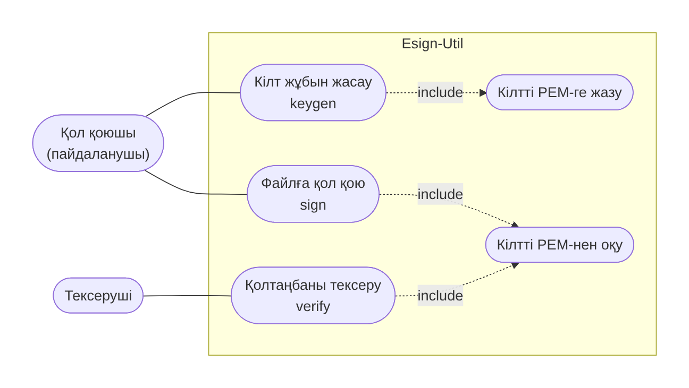
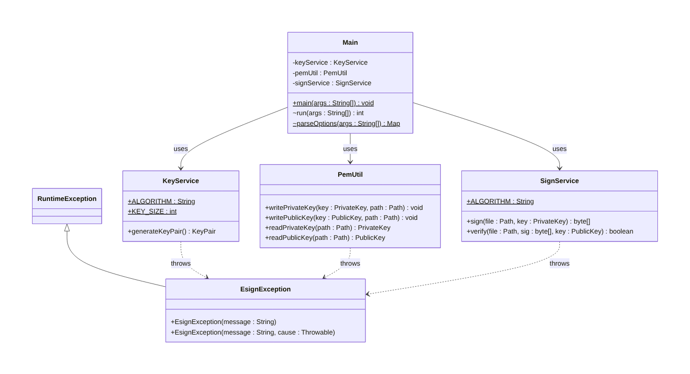
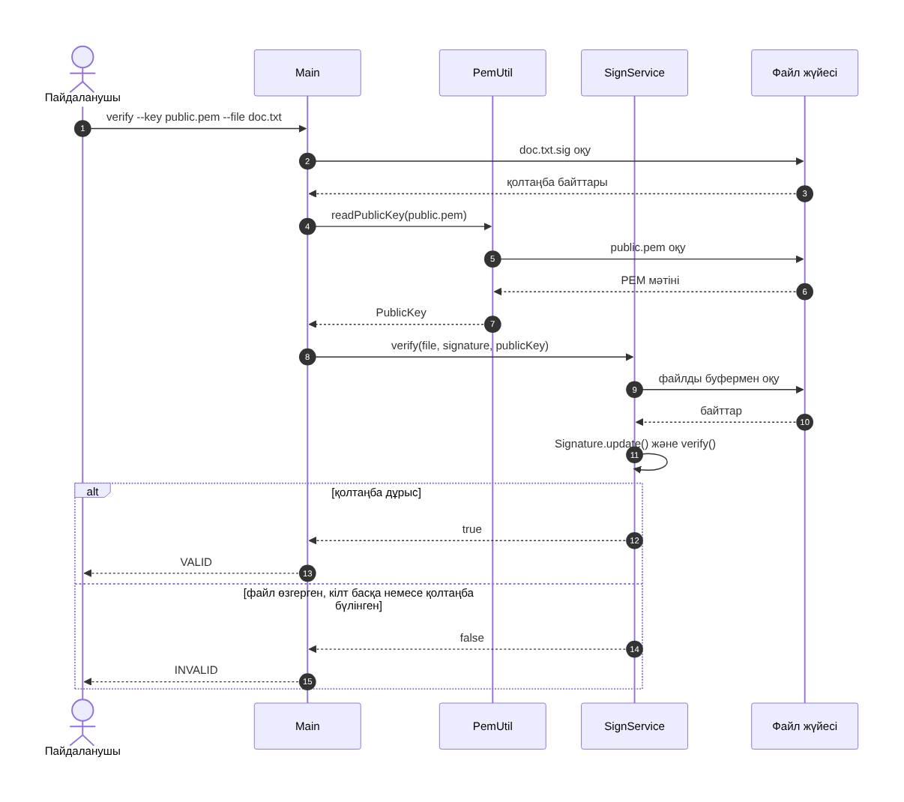

# Esign-Util — RSA-2048 электрондық қолтаңба утилитасы

Java консольдік утилитасы: RSA-2048 кілт жұбын жасайды, файлға **SHA256withRSA** арқылы қол қояды және қолтаңбаны тексереді. Кілттер **PEM** форматында сақталады.

> Оқу жобасы: «Комп жүйе қауіпсіздігі», ИП2408k, 11-тақырып.

## Жобаның мақсаты

Ұйымдағы электрондық құжаттың өзгертілмегенін және нақты жіберушіден келгенін дәлелдеу. Тек стандартты Java криптографиясы (JCA) қолданылады: `KeyPairGenerator`, `Signature`, `KeyFactory`.

## Зерттелген ұйым

Ұйымның құжат айналымы: бұйрық, шарт, есеп сияқты файлдар электрондық пошта арқылы жіберіледі және алушы олардың өзгертілмегенін тексеруі керек. Акторлар (қол қоюшы, тексеруші), функционалдық және функционалдық емес талаптар [docs/research.md](docs/research.md) файлында.

## Мүмкіндіктер

| Команда | Әрекет |
|---|---|
| `keygen` | RSA-2048 кілт жұбын жасап, PEM файлдарға сақтайды |
| `sign` | Файлға жеке кілтпен қол қояды, `.sig` файл жасайды |
| `verify` | Файл мен `.sig` қолтаңбасын ашық кілтпен тексереді |

Шығу коды: `0` сәтті, `1` қате, `2` қолтаңба `INVALID`.

## Талаптар

JDK 17+ және Maven 3.8+.

## Іске қосу

```bash
git clone https://github.com/<username>/java-project-<тегі>-11.git
cd java-project-<тегі>-11
mvn clean package
```

Нәтиже: `target/esign-util.jar`.

```bash
# 1. Кілт жұбын жасау
java -jar target/esign-util.jar keygen --out keys

# 2. Үлгі құжатқа қол қою (data/sample.txt)
java -jar target/esign-util.jar sign --key keys/private.pem --file data/sample.txt
#  -> data/sample.txt.sig

# 3. Қолтаңбаны тексеру
java -jar target/esign-util.jar verify --key keys/public.pem --file data/sample.txt
#  -> VALID

# 4. Файлды өзгертіп, қайта тексеру
echo "өзгеріс" >> data/sample.txt
java -jar target/esign-util.jar verify --key keys/public.pem --file data/sample.txt
#  -> INVALID
```

Тесттерді іске қосу:

```bash
mvn test
```

## Экран суреттері


## UML диаграммалар

| Диаграмма | Сурет | Бастапқы файл |
|---|---|---|
| Use Case | `docs/uml/use-case.png` | `docs/uml/use-case.mmd` |
| Class | `docs/uml/class.png` | `docs/uml/class.mmd` |
| Sequence (verify) | `docs/uml/sequence.png` | `docs/uml/sequence.mmd` |





## Репозиторий құрылымы

```
java-project-<тегі>-11/
├── README.md
├── docs/
│   ├── research.md
│   └── uml/                 # use-case, class, sequence: .png + .mmd
├── src/main/java/kz/esign/
│   ├── Main.java            # консоль командалары
│   ├── KeyService.java      # RSA-2048 кілт жұбы
│   ├── PemUtil.java         # PEM оқу/жазу
│   ├── SignService.java     # қол қою / тексеру
│   └── EsignException.java
├── src/test/java/kz/esign/  # JUnit 5 тесттер (14)
├── data/sample.txt          # үлгі құжат
├── pom.xml
├── .gitignore
└── .github/workflows/ci.yml # GitHub Actions
```

## Қауіпсіздік ескертпесі

- **`private.pem` файлын ешқашан GitHub-қа жүктемеңіз.** `.gitignore` ішінде `*.pem`, `keys/`, `.env` бар.
- Жеке кілт PKCS#8, ашық кілт X.509 форматында; жеке кілт файлы `rw-------` рұқсатымен жазылады.
- Оқу жобасы: жеке кілт шифрланбаған күйде сақталады. Нақты жүйеде пароль, KeyStore немесе HSM қолдану керек.
- Қолтаңба тұтастық пен авторлықты береді, файлды шифрламайды.
- MD5 және SHA-1 қолданылмайды.

## Лицензия

MIT
